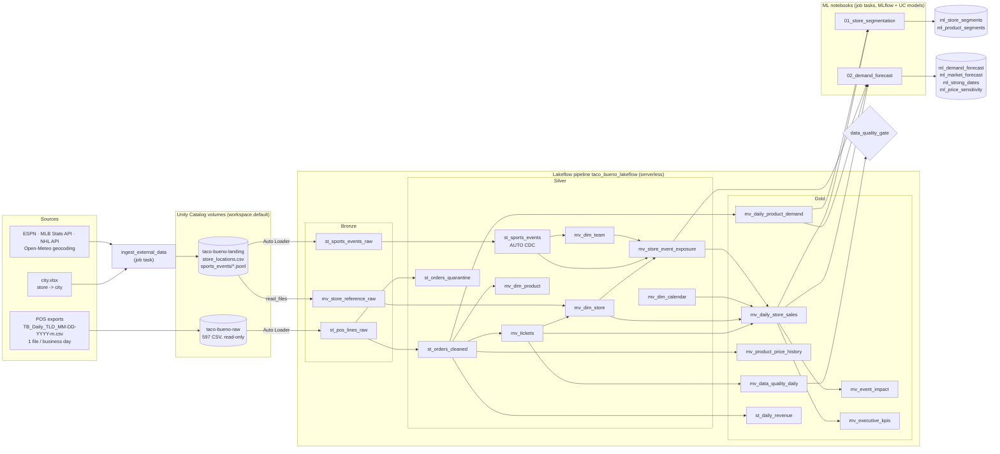

# Pipeline overview

## Architecture

Everything is in the `workspace` catalog: pipeline tables in schema `taco_bueno` (prod) or `dev_<user>_taco_bueno` (dev), source volumes in `default`.

## How data flows from source to output

| Step | Input | What happens | Output |
|---|---|---|---|
| 1. Land | Daily POS export | Uploaded unmodified to the raw volume (the file-arrival trigger starts the job) | `/Volumes/workspace/default/taco-bueno-raw/` |
| 2. External data | `city.xlsx`, sports APIs | Geocode store cities; fetch schedules and results (last 14 days + next 120) | landing volume: CSV + JSON Lines batch |
| 3. Bronze | Raw files | Auto Loader reads only new files with an all-STRING positional schema; lineage columns added | `st_pos_lines_raw` (85.3M lines), `st_sports_events_raw`, `mv_store_reference_raw` |
| 4. Silver: clean | Bronze lines | Parse types, harmonize the two POS systems, channel, daypart, product key, ticket key; blocking rules route bad rows to quarantine | `st_orders_cleaned`, `st_orders_quarantine` |
| 5. Silver: model | Clean lines, reference, games | Tickets (13.8M) with gross/net/collected sales; store, product, calendar and team dimensions; deduplicated game calendar (AUTO CDC); store-game exposure by distance | `mv_tickets`, `mv_dim_*`, `st_sports_events`, `mv_store_event_exposure` |
| 6. Gold | Silver | Store-day facts with calendar and sports context and baselines; product-day demand; price history; event impact; KPIs; quality scorecard; streaming ledger | `mv_daily_store_sales` (63,868 store-days) and the other gold tables |
| 7. Gate | Gold + event log | Error-level checks stop the run before anything is published downstream | `dq_gate_results` |
| 8. ML | Gold | Store and product segments (weekly); product, combo and market forecasts, strong dates and price sensitivity (daily) | `ml_*` tables, MLflow runs, UC models |
| 9. Consume | Gold + ML | AI/BI dashboard deployed by the bundle (`taco_bueno_overview`), SQL editor, pricing and operations decisions | [06_analysis_and_business_value.md](06_analysis_and_business_value.md) |

## A daily run, end to end

1. The POS export for business day *D* lands in the raw volume.
2. 15 minutes after the upload settles, the file-arrival trigger starts `taco_bueno_daily_orchestration`.
3. `ingest_external_data` writes a new sports batch (about 3,000 games for the rolling window) to the landing volume.
4. The pipeline update ingests the one new POS file and the new sports batch incrementally, then refreshes the materialized views. Day *D* appears in every gold table, and day *D-1* is finalized in the streaming ledger.
5. The quality gate checks reconciliation, quarantine share, ticket-key integrity, freshness and coverage.
6. On Mondays (or on demand) the segments are retrained; every day, forecasts and the strong-date calendar are refreshed for the next 95 days.

## Design choices

* **Medallion layers with clear contracts.** Bronze never fails on format changes (everything is a string). Silver owns parsing, harmonization and quality rules. Gold owns business-ready aggregates and comparisons.
* **Streaming where data is append-only, materialized views where results must be exact and recomputable.** See [05_technical_best_practices.md](05_technical_best_practices.md).
* **External data is decoupled from sales.** Sports ingestion is a separate fail-soft task writing to its own volume, so an API outage never blocks sales reporting.
* **Everything is code.** The bundle (`databricks.yml` + `resources/`) deploys the schema, the pipeline and the job to dev and prod.
