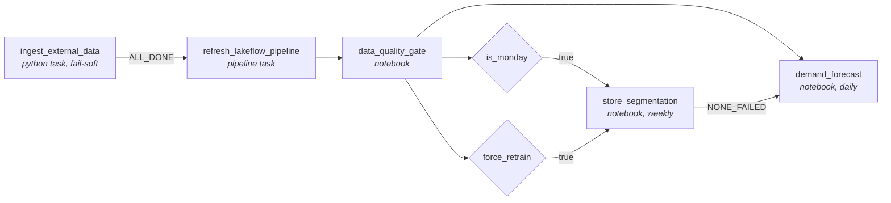

# Pipeline job: `taco_bueno_daily_orchestration`

Defined in [`resources/jobs/daily_orchestration_job.yml`](../resources/jobs/daily_orchestration_job.yml) and deployed with the bundle. It orchestrates everything that has to happen when a new POS export lands: external data, the Lakeflow pipeline, a data-quality gate and the ML refresh.

## Task graph



| Task | Type | What it does | Depends on | Retries / timeout |
|---|---|---|---|---|
| `ingest_external_data` | Python script (serverless, environment with `requests`, `openpyxl`) | Pulls sports schedules and results for the last 14 days and the next 120 days from ESPN, MLB Stats API and NHL API into the landing volume (new immutable batch folder per run). | none | 2 retries, 5 min apart; 30 min timeout |
| `refresh_lakeflow_pipeline` | Pipeline task | Incremental update of `taco_bueno_lakeflow`: Auto Loader picks up only the new POS file and the new sports batch; materialized views refresh. | `ingest_external_data` with `run_if: ALL_DONE` | 1 retry after 10 min; 2 h timeout |
| `data_quality_gate` | Notebook | Error-level checks (reconciliation >= 99.5%, quarantine <= 0.5%, one header per ticket) fail the run; warnings (freshness, missing days, stores without location, failed expectations) are logged. Results are appended to `dq_gate_results`. | `refresh_lakeflow_pipeline` | 30 min timeout |
| `is_monday`, `force_retrain` | Condition tasks | `{{job.start_time.iso_weekday}} == 1`, or the job parameter `force_retrain_segments == true`. | `data_quality_gate` | none |
| `store_segmentation` | Notebook | Re-fits store segments and product demand-pattern clusters, logs them to MLflow and registers the models in Unity Catalog. | either condition true (`AT_LEAST_ONE_SUCCESS`) | 1 retry; 1 h timeout |
| `demand_forecast` | Notebook | Backtests and refits the product/combo and market traffic models, publishes forecasts and the strong-date calendar. | `data_quality_gate` and `store_segmentation` with `run_if: NONE_FAILED` (runs whether segmentation ran or was skipped) | 1 retry; 1 h timeout |

All tasks run on **serverless** compute: there are no clusters to size or keep alive, and billing stops when the run ends.

## Triggering and scheduling

* **Primary trigger: file arrival** on `/Volumes/workspace/default/taco-bueno-raw/`. The POS system exports one file per business day; the job starts when it appears, waits 15 minutes after the last change (`wait_after_last_change_seconds: 900`) so a slow upload is never read half-written, and never starts twice within an hour (`min_time_between_triggers_seconds: 3600`).
* **Alternative: schedule.** A job has a single trigger type. If the export is guaranteed by a fixed time, replace the `trigger` block with:

  ```yaml
  schedule:
    quartz_cron_expression: "0 0 6 * * ?"   # 06:00 every day
    timezone_id: America/Chicago
  ```
* **Manual / backfill runs:** `databricks bundle run daily_orchestration_job -t prod` (add `--params force_retrain_segments=true` to retrain the segments on demand).
* **Concurrency:** `max_concurrent_runs: 1` with `queue.enabled: true`. If two files land close together, the second run waits instead of competing for the same tables.
* **Dev vs prod:** in the `dev` target (development mode) the trigger is paused and resources are prefixed with `[dev <user>]`; the `prod` target deploys the same definitions unpaused.

## Failures, alerts and reruns

| Situation | What happens | What to do |
|---|---|---|
| Sports API down or rate-limited | The ingestion task logs a warning and exits 0 (`--fail-on-error false`). The pipeline still runs on the sports data already landed; `sports_events_age_hours` raises a warning in the gate. | Nothing. The next run fills the window (it always re-fetches 14 days back). |
| Transient failure (network, serverless capacity) | Task-level retries (`max_retries`, `min_retry_interval_millis`). | Nothing. |
| Pipeline update fails | Task fails after its retry; on-failure e-mail to `notification_email`; the pipeline also e-mails on update/flow failure. Downstream tasks do not run. | Fix the cause, then **Repair run**: only the failed task and its dependents re-run. |
| Bad data (quality gate fails) | The run stops before the ML tasks, so no forecast is published on top of bad data. Details in `dq_gate_results`. | Inspect `st_orders_quarantine` and `mv_data_quality_daily`, correct the source, Repair run. |
| Run takes too long | Health rule `RUN_DURATION_SECONDS > 7200` sends a warning e-mail; job timeout at 4 h. | Check the pipeline event log for the slow flow. |
| Late or re-delivered export | Auto Loader ingests a file once per path (exactly-once checkpoint). A missing day shows as `Missing file` in `mv_data_quality_daily` until it arrives; when it does, the next update ingests it and the materialized views include it. | Drop the file in the raw volume; the trigger fires. |
| Logic change that needs history recomputed | Not automatic. | `databricks bundle run taco_bueno_lakeflow -t prod --full-refresh-all` (or `--full-refresh <table>` for one table). |

### Why reruns are safe (idempotency)

* **Bronze**: Auto Loader records every ingested file in its checkpoint, so rerunning never duplicates rows.
* **Sports events**: AUTO CDC keeps one row per `event_id` ordered by `fetched_at`; re-fetching the same window updates rows instead of adding them.
* **Silver/gold materialized views**: declarative, so each refresh produces the same result for the same inputs.
* **ML tables**: written with `overwrite`, and each run is a new MLflow run; the registered model version records which run published what.
* **`dq_gate_results`**: append-only by design (it is the history of the checks), keyed by `run_ts`.

## Parameters

| Parameter | Default | Used by |
|---|---|---|
| `catalog` | `workspace` | quality gate, ML notebooks |
| `schema` | bundle schema (`taco_bueno` in prod) | quality gate, ML notebooks |
| `force_retrain_segments` | `false` | `force_retrain` condition |
| `forecast_horizon_days` | `95` | `demand_forecast` |

Bundle variables (in `databricks.yml`) set the volume paths, the local/regional radius for sports matching and the alert recipient.

## Verified run

The full job ran on serverless compute in the `dev` target (`[dev a01750690] taco_bueno_daily_orchestration`):

| Task | Result |
|---|---|
| `ingest_external_data` | fetched 3,071 games for the rolling window directly from ESPN, MLB Stats API and NHL API inside Databricks (serverless egress works) |
| `refresh_lakeflow_pipeline` | incremental update: only the new sports batch was ingested; materialized views refreshed |
| `data_quality_gate` | passed: every error-level check green (reconciliation 99.92% over the last 7 days, 0 quarantined rows, 0 inconsistent headers); warnings for freshness (the historical dataset ends 2026-09-27), 11 stores without location and 8 expectations with failures |
| `is_monday` / `force_retrain` | `force_retrain_segments=true` routed to segmentation |
| `store_segmentation` | 4 store segments, 3 product clusters, both models registered |
| `demand_forecast` | first attempt failed on a pandas API difference (`Series.clip(min=)`), fixed and recovered with **Repair run** (only the failed task re-ran, as documented above) |

Before that, two deployment issues specific to serverless Python tasks were found and fixed in `run_ingestion.py`. The script is executed through `exec()`, so `__file__` is undefined. It also runs inside IPython, where even `sys.exit(0)` is reported as a failure, so the script now exits explicitly only on errors.
