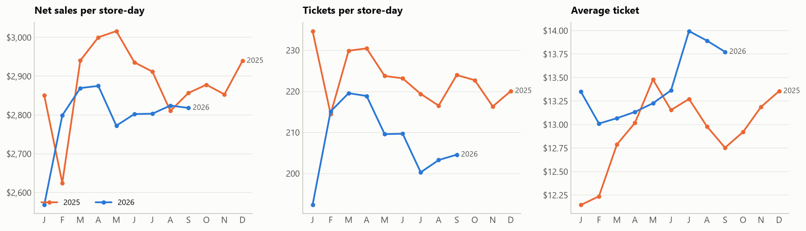
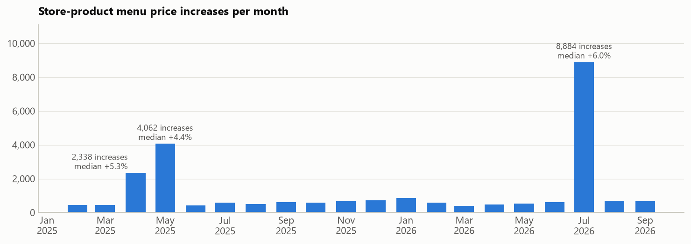
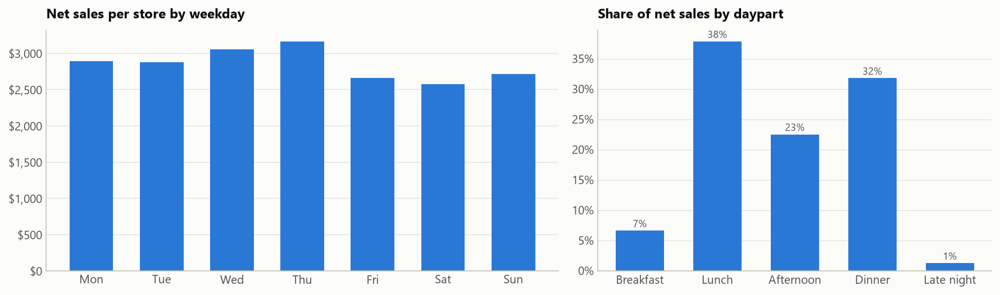
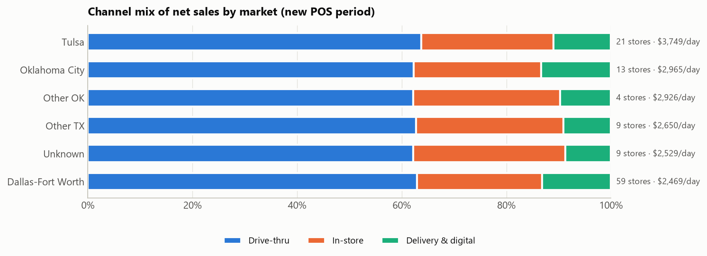
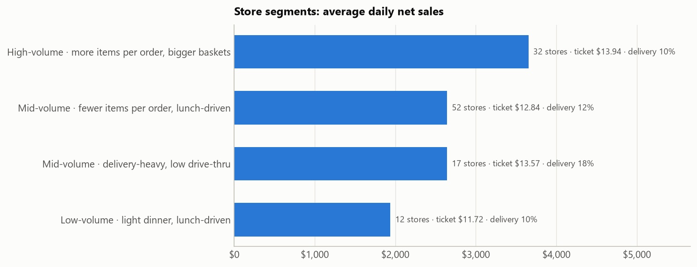
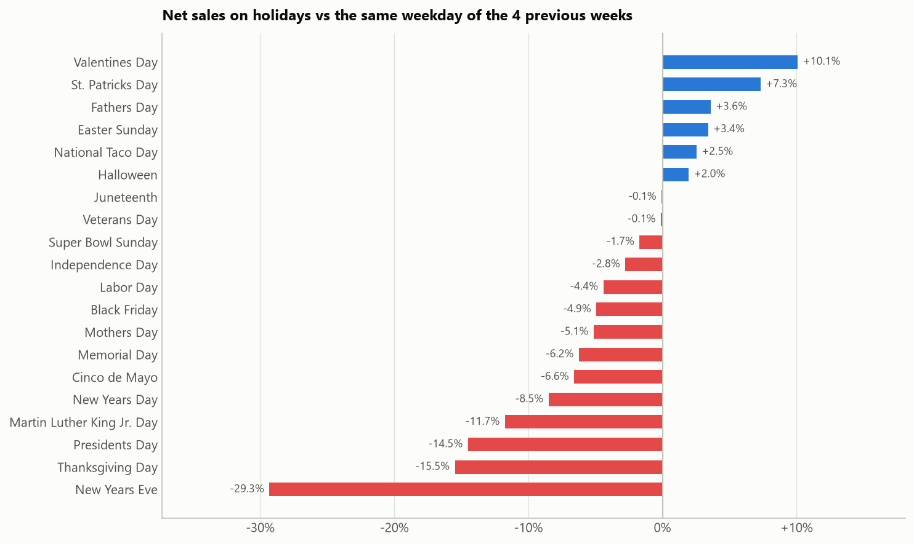
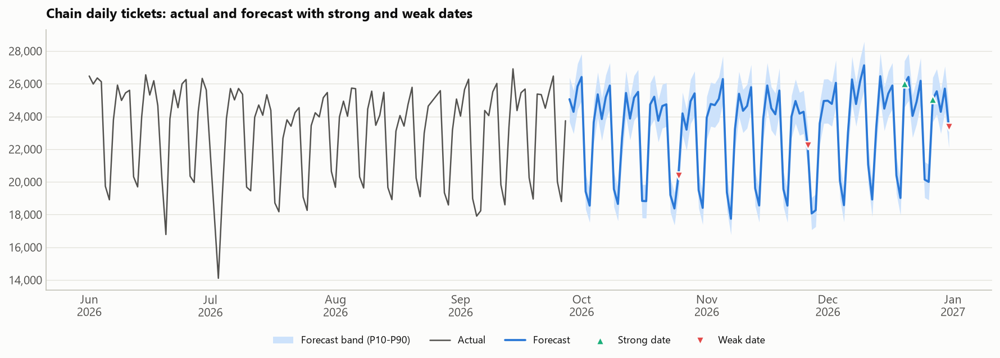
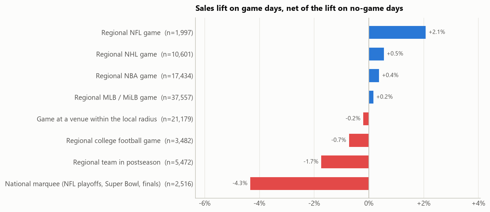
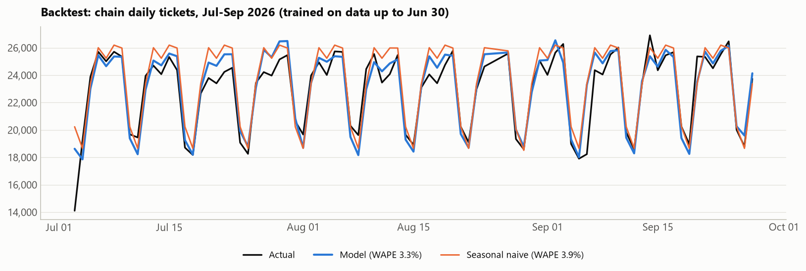
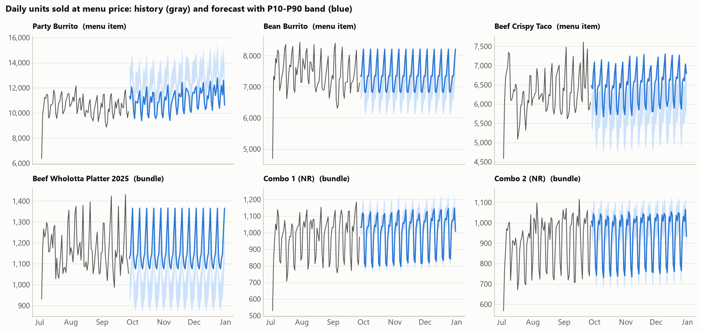

# Analysis and business value

The figures below come from the gold and ML tables. Each one can be reproduced with [`src/analysis/business_insights.sql`](../src/analysis/business_insights.sql), and the charts with [`tools/analysis/make_charts.py`](../tools/analysis/make_charts.py).

**Scope:** 573 business days (2025-01-22 to 2026-09-27), 119 stores in Texas and Oklahoma, 13.79M tickets, **$181.7M net sales** (after discounts, before tax), $13.18 average ticket, $2,845 net sales per store-day.

## Key findings

1. **Traffic is eroding and price increases are carrying sales.** Tickets per store-day ran 4.5% to 8.7% below the prior year every month from March 2026, while the average ticket rose up to 8.0%, so sales per store-day moved between -8.1% and +0.5%.
2. **Two chain-wide price waves** (April-May 2025, about +4-5%; July 2026, +6.0% on 8,884 store-product prices) explain most of the ticket growth. After July 2026, traffic fell 6-9% YoY.
3. **Delivery is the growth channel:** from 10.4% of sales in February 2026 to 14.0% in September, with tickets of about $22 vs $12.5 at the drive-thru.
4. **Dallas-Fort Worth underperforms.** It has half of the stores (59) but the lowest productivity, $2,469 per store-day vs $3,749 in Tulsa. 41 of its 59 stores are in the lunch-driven or low-volume segments.
5. **Calendar matters more than sports.** Holidays move sales by -29% to +10%, and the biggest shocks are region-wide drops that look weather-driven. Game days shift sales by a few percent, and big weekend games *reduce* restaurant traffic.
6. **Forecasts beat a seasonal-naive baseline for traffic and combos** (3.3% vs 3.9% WAPE on chain tickets, 7.5% vs 10.4% for bundles) but not yet for single menu items.

## 1. Sales trend and pricing

| Month (2026) | Sales / store-day YoY | Tickets / store-day YoY | Avg ticket YoY |
|---|---:|---:|---:|
| Feb | +6.6% | +0.3% | +6.3% |
| Mar | -2.4% | -4.5% | +2.2% |
| Apr | -4.2% | -5.0% | +0.9% |
| May | -8.1% | -6.3% | -1.9% |
| Jun | -4.5% | -6.1% | +1.6% |
| Jul | -3.7% | -8.7% | +5.4% |
| Aug | +0.5% | -6.1% | +7.0% |
| Sep | -1.4% | -8.7% | +8.0% |

Productivity is measured per store-day so store openings and closures and missing export days do not distort the comparison (January is excluded: only 6 days of 2025 data).

`mv_product_price_history` tracks the most common menu price of each product in each store and month. Two waves stand out: April-May 2025 (2,338 and 4,062 store-product increases, median +5.3% and +4.4%) and July 2026 (8,884 increases, median +6.0%). Discounts also fell from 6.2% of gross sales in January 2025 to about 2% in 2026.

**Business value:** the pricing team can see that recent revenue holds up because of price, not traffic. A third broad increase risks accelerating the traffic decline; value-led actions (next sections) are the lever to recover visits.

## 2. Where and when sales happen

* **A weekday lunch business:** Wednesday and Thursday peak at $3,051 and $3,161 per store. Friday ($2,657) and Saturday ($2,570) are the weakest days, with about 25% fewer tickets than midweek; Sunday ($2,713) sits in between. Lunch is 38% of sales, dinner 32%, afternoon 22%, breakfast 6%, late night 1%.
* **Channels** (new-POS period, the only one that tracks delivery): drive-thru 62.9%, in-store 25.1%, delivery and digital 11.9%.
* **Mix:** Combos & Platters are 22.0% of item sales, Tacos 17.6%, Burritos 16.3%, the value menu ("Bueno Under a Buck") 10.3%, Beverages 8.5%. 44 of 647 product names make up 80% of sales.

**Business value:** weekend traffic is where the gap is largest. Weekend family bundles and delivery-only offers target the days and channel with the most headroom.

## 3. Markets and store segments

* Tulsa (21 stores) leads with $3,749 per store-day and 276 tickets per day. Oklahoma City follows at $2,965. Dallas-Fort Worth (59 stores) is last at $2,469 and 187 tickets per day, with the same channel mix as other markets, so the gap is traffic, not format.
* **Store segments** (k-means, see [07](07_ml_models.md)): 32 *high-volume, bigger-basket* stores ($3,653/day; 12 of them in Tulsa), 52 *lunch-driven, smaller-basket* stores ($2,643; 33 in DFW), 17 *delivery-heavy* stores (18% delivery), 12 *low-volume* stores ($1,939; 8 in DFW).

**Business value:** segments give operations and marketing like-for-like peer groups. A DFW lunch-driven store should be benchmarked against its segment, not against Tulsa. The segments are also the natural strata for controlled price and promotion tests.

## 4. Calendar: holidays and strong dates

Lift = net sales against the same weekday of the 4 previous weeks (ratio of sums over all stores). Each holiday appears once or twice in the data (some 2025 holidays fall on missing export days), so treat small differences as indicative:

* **Strong days:** Valentine's Day +10.1%, St. Patrick's Day +7.3%, Father's Day +3.6%, Easter +3.4%, National Taco Day +2.5%.
* **Weak days:** New Year's Eve -29.3%, Thanksgiving -15.5%, Presidents Day -14.5%, MLK Day -11.7%, New Year's Day -8.5%, **Cinco de Mayo -6.6%** (surprising for a Mexican-food chain), Memorial Day -6.2%, Mother's Day -5.1%.
* **Region-wide shocks:** the deepest historical drops (Jan 25-26, 2026: -73% and -47%; Feb 17-18, 2025: about -45%; and July 3 in both years) hit every market at once. The pattern points to severe winter weather and early closures rather than the holidays or games that coincide with them. **Weather is the most valuable next data source** (e.g. the free Open-Meteo history API, already used for geocoding).

Forecast strong and weak dates for the rest of 2026 (`ml_strong_dates`):

| Date | Expected vs baseline | Class | Coinciding factors |
|---|---:|---|---|
| Sun Oct 25 | -14.6% | Weak | NFL Sunday (Giants at Texans) |
| Thu Nov 26 | -14.4% | Weak | Thanksgiving; Eagles at Cowboys |
| Sun Dec 20 | +11.0% | Strong | Last Sunday before Christmas; Cowboys at Rams |
| Sun Dec 27 | +7.6% | Strong | Jaguars at Cowboys |
| Thu Dec 31 | -11.9% | Weak | New Year's Eve |

**Business value:** staffing and inventory can be planned around a dated calendar of strong and weak days. The Cinco de Mayo and National Taco Day results show untapped marketing moments: a +2.5% Taco Day is small for a taco brand.

## 5. Sports events

25,546 games from seven leagues were matched to every store by distance (see [08](08_sports_events.md)). Effects are measured against no-game days on the same weekday baseline:

| Exposure | Weekday | Weekend |
|---|---:|---:|
| Regional NFL game | **+1.8%** | 0.0% |
| Regional NBA game | **+1.2%** | -3.2% |
| Regional NHL game | +1.0% | -2.0% |
| Regional MLB / MiLB game | +0.6% | -2.2% |
| Regional college football game | -0.4% | -3.1% |
| Regional team in postseason | -1.2% | **-4.5%** |
| National marquee (NFL playoffs, Super Bowl, finals) | -1.6% | **-9.8%** |

* **Weekday games bring a small lift**, likely dinner pick-up before or during evening games.
* **Big weekend games pull customers away from restaurants.** In DFW and OKC, weekend regional NFL, college football and playoff games run 6% to 13% below no-game weekends.
* Daily chain or market totals barely depend on sports (low feature importance in the forecasts), so sports matter for **targeted actions**, not for the overall plan.

**Business value:** turn the weekend game-day dip into delivery and catering demand, e.g. Wholotta Box and party-pack promotions for watch parties on Cowboys, Sooners/Cowboys (OSU) and Thunder game days, pushed through the delivery apps. The 18% delivery segment is the natural pilot group.

## 6. Demand forecasts

* **Traffic:** chain daily tickets are forecast within 3.3% WAPE over an 89-day backtest (seasonal naive: 3.9%); market-level tickets per store 4.3% vs 5.1%.
* **Combos and platters:** 7.5% vs 10.4%. The model follows assortment changes (Party Combo: 11% vs 83%).
* **Single menu items:** the recent weekday average remains better (7.9% vs 10.0%). It is kept in the selection and re-evaluated every day.
* **Next 95 days:** 2.21M tickets and $31.1M net sales expected (P10-P90 about $30.1M-$33.4M).

**Business value:** daily product and combo forecasts with prediction bands feed prep and ordering (component demand follows from bundle forecasts). Market traffic forecasts feed labor scheduling.

## 7. Price sensitivity

`ml_price_sensitivity` re-scores the forecast with every menu price +5%. Value items respond as expected: Party Quesadilla -0.61, Party Burrito -0.54, Chips & Queso -0.50 elasticity. Core items show no reliable response, because past price changes were chain-wide and coincided with seasonal shifts, so the data cannot separate price from season.

**Recommendation:** before the next price move, run a controlled test: raise prices in a subset of stores from each segment, keep matched control stores, and measure with the same baseline and lift tables. This turns the elasticity question into a measurement instead of a guess.

## 8. Value of the data foundation

* **One trustworthy number:** 91 of 91 reconciliation metrics match an independent implementation to the cent, across two POS systems with different semantics.
* **Defects found and fixed before they reached reports:** 72 reused check numbers that silently merged tickets, ESPN timestamps that dropped 7,874 games, a floating-point threshold flip.
* **Visible gaps:** 41 missing export days (including Christmas week 2025) and 11 stores missing from the city file are flagged daily, not discovered months later.

## Recommendations

| # | Action | Evidence | Expected value |
|---|---|---|---|
| 1 | Pause broad price increases; run a matched-store price test by segment | Traffic -6% to -9% YoY after the July 2026 wave; elasticities not identifiable from history | Avoid accelerating traffic loss; measured elasticities |
| 2 | Weekend and game-day delivery bundles (Wholotta Box, party packs) | Weekends are 25% below midweek; big weekend games -4.5% to -9.8%; delivery growing to 14% | Recover weekend traffic through the growing channel |
| 3 | DFW turnaround plan benchmarked by segment | 59 stores at $2,469 vs $3,749 in Tulsa; 41 in the lunch-driven or low-volume segments | Closing a quarter of the gap to Tulsa adds about $19K of net sales per day |
| 4 | Own the brand's moments: Cinco de Mayo and National Taco Day campaigns | -6.6% and +2.5% vs baseline | Turn weak or flat days into strong days |
| 5 | Add daily weather to the pipeline | Largest historical drops are region-wide and weather-like | Better strong/weak-day forecasts and staffing |
| 6 | Complete the reference data | 11 stores (4.75% of sales) lack a city; Christmas-week exports missing | Full sports/market coverage; holiday forecasts |
